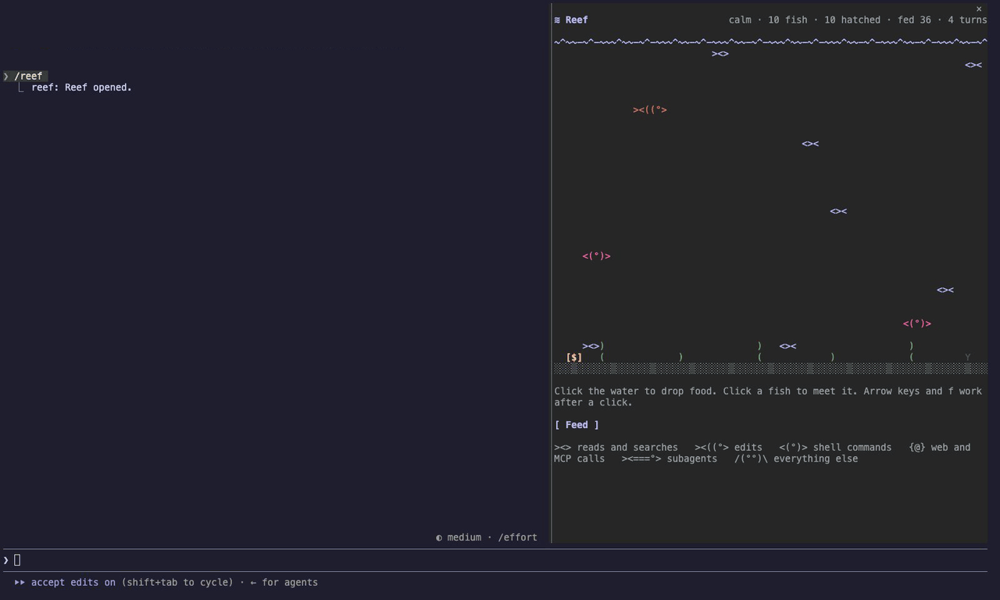
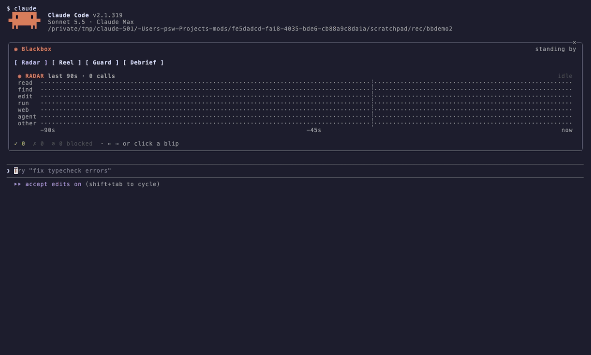

# Claude Code mods

Four mods for [Claude Code](https://code.claude.com), plus study notes, a starter template and a generator for building your own.

A mod is a plugin that changes Claude Code itself: a pane beside the chat, a band above the prompt, a card under a tool call, a guard on what tools may run. It is one TypeScript/JSX module that hooks engine events and draws with the engine's own elements. Every recording below is a real Claude Code session in a terminal with the mod loaded.

## The mods

### reef

A living ASCII aquarium beside the chat. Claude's work keeps it alive.



- Every successful tool call drops a food pellet, and the nearest fish swims over to eat it.
- The first three calls each hatch a fish, then one more hatches every 4 calls. The species follows the tool: `><>` minnows for reads and searches, `><((°>` angelfish for edits, `<(°)>` pufferfish for shell commands, `{@}` jellyfish for web and MCP calls, `><===°>` whales for subagents.
- A failed call sinks a red `✗` to the sand. Each finished turn grows the seaweed. After 45 quiet seconds the lights dim and the fish fall asleep.
- Click the water to feed them yourself. Click a fish to see its name and the tool call it hatched from.
- The reef is saved between sessions.

`/reef` opens it. `/reef-reset` starts over.

### blackbox

A flight recorder for a Claude Code session.



- **Radar.** Every tool call as a live blip on seven lanes (read, find, edit, run, web, agent, other) over the last 90 seconds. Running calls pulse. Click a blip to select it.
- **Reel.** Every edit as a unified diff you can step through, and a one-line impact card under each edit row in the transcript (`+3 −1 · 2nd change to app.ts`).
- **Guard.** Blocks `rm -rf`, force pushes, `git reset --hard` and `git clean -f`, `curl | sh`, and writes to `.env` files before they run, and tells Claude why. Each rule can be switched off.
- **Debrief.** A one-press summary of the session's changes, written by Haiku.
- **REC band.** A blinking recorder above the prompt while a turn runs, and a summary after it.

`/blackbox` opens it. `/blackbox-reset` clears the recording.

### cockpit

A session dashboard: context meter, cost, turn and tool counts, sparklines of context and turn time, a tool call log, and a ranking of the files Claude read and edited. A band above the prompt shows context and cost, and the status line shows `ctx 42% · $0.31` after each turn. `/cockpit` opens it.

### mods-lab

A test bench for the mods API. Each probe calls one API (`$.ui.toast`, `$.fs.read`, `$.model.complete` and the rest) and records whether your build answered it, with the exact error when it did not. Use it to see what works before you design a mod. `/lab` opens it, and `claude -p "/lab run"` prints the results headless.

## Install

At the prompt of a Claude Code terminal session:

```
/plugin install reef --marketplace sangwookp9591/claude-code-mods
/plugin install blackbox --marketplace sangwookp9591/claude-code-mods
/plugin install cockpit --marketplace sangwookp9591/claude-code-mods
/plugin install mods-lab --marketplace sangwookp9591/claude-code-mods
```

From a shell, use `claude plugin install reef --marketplace sangwookp9591/claude-code-mods`. The first install asks whether to add the marketplace. Answer `y` and pick a scope.

In the desktop app, press + next to the prompt, then Plugins, then Add marketplace, enter `sangwookp9591/claude-code-mods`, and press Add plugin.

Panes animate in the terminal and the desktop app. VS Code and mobile get a static fallback.

## Try them without installing

```bash
git clone https://github.com/sangwookp9591/claude-code-mods
cd claude-code-mods
claude --plugin-dir ./mods/reef --plugin-dir ./mods/blackbox --plugin-dir ./mods/cockpit --plugin-dir ./mods/mods-lab
```

## Build your own

```bash
./scripts/new-mod.sh my-board "My Board" "One line about what it does"
claude plugin validate ./mods/my-board
claude plugin test ./mods/my-board
claude --plugin-dir ./mods/my-board
```

The generator copies `template/mod-starter`, which has a pane, a band, a slash command, a typed state contract, a small UI kit (`hooks/kit.tsx`) and a test file. Every mod here ships its tests under `tests/`, run by `claude plugin test`.

## Repository layout

| Path | What it holds |
| :- | :- |
| `mods/reef/` | The aquarium |
| `mods/blackbox/` | The flight recorder |
| `mods/cockpit/` | The session dashboard |
| `mods/mods-lab/` | The API test bench |
| `template/mod-starter/` | Skeleton for a new mod, with the UI kit |
| `scripts/new-mod.sh` | Generator that copies the template |
| `docs/01-overview.md` … `docs/09-reference.md` | Study notes on the nine official mods pages, each ending in a test checklist (Korean) |
| `docs/10-design-system.md` | Design tokens, components, layout and test rules for mods (Korean) |
| `docs/11-capability-matrix.md` | What each API did when measured with mods-lab (Korean) |

## Requirements

Claude Code v2.1.287 or later in the terminal. Everything here was checked on v2.1.319.

## License

MIT
